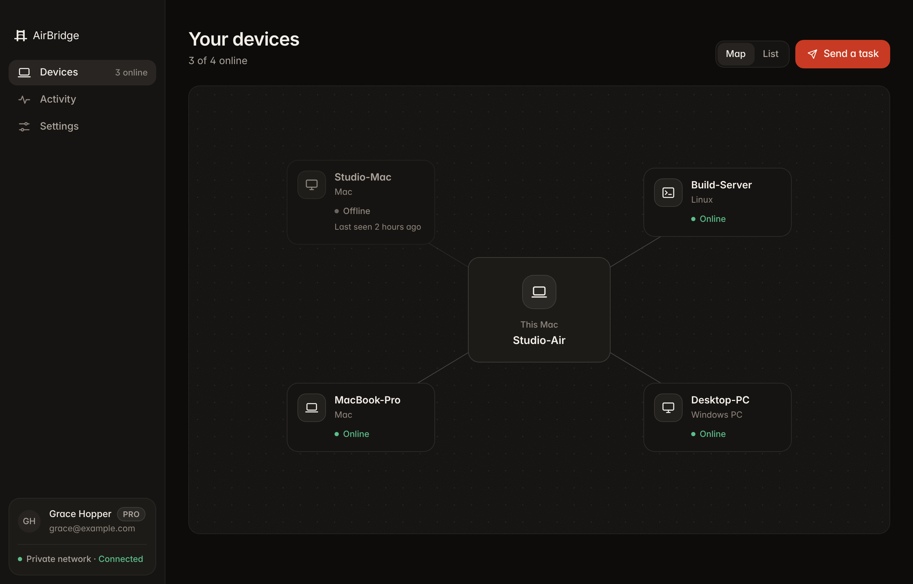

# AirBridge Pro (desktop)

AirBridge Pro is the desktop app for the computers you own. It lets the AI apps on those
computers (Claude Desktop, Cursor, Codex) hand tasks and code to each other, and gives you a
quiet place to see what is going on. It brings its own private network: there is nothing else to
install or sign in to. Any computer running AirBridge Pro and signed in to the same account
appears automatically.

- **Devices** shows a live map. This computer sits in the middle and your other computers are
  arranged around it, each marked *Online* or *Offline* with when it was last seen.
- **Activity** is a real-time feed written in plain sentences, such as "Received task from
  MacBook", "Sent code to Desktop-PC" and "Couldn't reach Studio-Mac — is it awake?".
- **Settings** gives you a one-click config snippet for Claude Desktop or Cursor, the private
  network's status (*Connected*, *Connecting…* or *Couldn't connect* with Retry; the address is
  behind *Details*), the health of the background service, and your account and plan.

Sign-in uses Clerk in your browser. A $15/month AirBridge Pro subscription (Stripe) unlocks
the app. Once a valid licence is confirmed, main starts the bundled network daemon, enrols this
computer in your account's private network, and then starts the Python `airbridge-core` daemon.
The Starting screen shows those two steps ("Connecting your private network", "Starting
AirBridge").

## Develop

```bash
cd desktop
npm install
AIRBRIDGE_DEV_MOCKS=1 npm run dev     # fake signed-in user + valid licence; this computer is
                                      # "Dev-Workstation", peers MacBook-Pro, Desktop-PC, Studio-Mac,
                                      # with live mock events
npm test                              # vitest (renderer tests run in jsdom)
npm run typecheck
```

`AIRBRIDGE_DEV_MOCKS` is honoured only in unpackaged builds.

## Build

```bash
npm run build:backend   # PyInstaller → resources/bin/<os>-<arch>/airbridge-core
npm run build           # electron-vite: out/main, out/preload, out/renderer
npm run dist            # electron-builder installers (signing/notarisation required for release)
```

## Architecture

```
┌──────────────────────────┐  window.airbridge   ┌──────────────┐   IPC (ab:*)   ┌──────────────────────────┐
│ Renderer (React+Tailwind)│ ◀─────────────────▶ │   Preload    │ ◀────────────▶ │          Main            │
│ sandboxed, no Node, CSP  │   frozen, Promise   │ contextBridge│  sender-origin │ auth (Clerk OIDC+PKCE)   │
│ SignIn·Paywall·Devices…  │   based API only    └──────────────┘   validated    │ licence gate (Ed25519)   │
└──────────────────────────┘                                                    │ network manager + enrol  │
                                                                                │ processManager           │
                                                                                └──────┬────────────┬──────┘
                                                      local socket / pipe, never argv  │            │ HTTP + WS on 127.0.0.1,
                                                                                       ▼            ▼ bearer token (main only)
                                                   ┌─────────────────────────────┐  ┌──────────────────────────┐
                                                   │ bundled private-network     │  │ airbridge-core --daemon  │
                                                   │ daemon (userspace, no admin)│◀─│ control API · events     │
                                                   │ local SOCKS5 + LocalAPI     │  │ inbox :8989 on 127.0.0.1 │
                                                   └──────────────┬──────────────┘  └──────────────────────────┘
                                                                  │ encrypted (WireGuard), same account only
                                                                  ▼
                                                   ┌─────────────────────────────┐
                                                   │ your other computers running│
                                                   │ AirBridge Pro               │
                                                   └─────────────────────────────┘
```

In short: renderer ⇄ preload ⇄ main ⇄ (bundled private-network daemon + `airbridge-core`).
The network daemon is built from the open-source Tailscale client (BSD-3; licence notices ship
in `resources/licenses/`) and talks only to AirBridge's own coordination server. See
`../airbridge/docs/PHASE3_PLAN.md`. The app UI never names it; it is just "your private network".

The renderer only ever talks to `window.airbridge` (see `src/shared/types.ts`). It never
sees the control token or any Clerk token.

### Renderer layout (`src/renderer`)

| Path | What it is |
|---|---|
| `App.tsx` | State machine (`deriveScreen`): loading → sign in → checking → paywall / starting (two steps: network, then backend) → ready, plus *Couldn't connect your devices* (network error) and *stopped unexpectedly* screens |
| `views/` | `SignIn`, `Paywall`, `Starting`, `ErrorScreen`, `MainShell`, `SwarmMap`, `ActivityFeed`, `Settings` |
| `components/` | `Sidebar` (footer line "Private network · Connected"), `PrivateNetworkCard`, `StatusDot`, `Card`, `Button`, `CopyButton`, `EmptyState`, `Toast`, `Skeleton`, `SendTaskSheet`, `DeviceGlyph`, hand-drawn `Icons` |
| `lib/` | `api.ts` (bridge access), `network.ts` (`window.airbridge.network` status hook, plain-language states), `hooks.ts` (5-second node polling, live events capped at 500), `format.ts` (event → sentence, relative time) |
| `styles.css` | Colour tokens as CSS variables. Dark by default, with a light palette under `prefers-color-scheme: light` |
| `devCsp.ts` | Vite plugin for the dev server only. It relaxes the CSP so HMR can work. Production keeps the strict policy |

### Design system

The aim is restraint in the spirit of Apple's System Settings and Find My. Hierarchy comes from
type, spacing and alignment, not from effects.

- **Brand:** the mark is a suspension-bridge tower seen head-on, with two legs, arched portal
  beams and the road deck passing through. It is monochrome (`currentColor`) and crisp at 16px.
  The concepts, the chosen mark (`docs/brand/logo.svg`) and the palette sheet are in
  `docs/brand/`. The app icon is `build/icon.svg`.
- **Colour:** a warm near-black canvas (`#0D0C0B`) with a subtle film grain and dot grid, warm
  off-white text (`#F2EEE8`) and warm greys. There is one accent, **International Orange**
  (`#C83A23` dark / `#C0362C` light, the Golden Gate's paint). It is used only for the single
  primary action on a screen. A calm green is used only for *Online*. Every text pair meets
  WCAG AA; see `docs/brand/palette.png`.
- **Surfaces:** flat cards with hairline borders and `rounded-2xl` corners. There are no glows,
  gradients or glass blur, and only overlays (sheet, toast) cast a shadow.
- **Status:** a small solid dot plus text, never colour alone and never pulsing.
- **Motion:** almost none. There are short one-shot fades for new items and the sheet, and a
  link on the device map brightens briefly when a task is sent. Nothing loops except the
  loading spinner. Everything turns off under `prefers-reduced-motion`.
- **Type:** system stack (`-apple-system` / SF Pro, Segoe UI Variable). Spacing follows an
  8-point grid.
- **Accessibility:** landmarks, a skip link, visible focus rings, full keyboard navigation
  (tabs, arrow keys, Esc, ⌘/Ctrl+1–3 to switch views, ⌘/Ctrl+N for *Send a task*), live
  regions, and body text that meets WCAG AA contrast. axe-core runs in the test suite.

## Screenshots

| | |
|---|---|
|  |  |
|  |  |
|  |  |

More states (Starting steps, network error, private network *Details* and *Connecting…*, no
other devices, Send-a-task sheet, light mode, narrow window) are in `docs/screenshots/extra/`.
They were rendered with Playwright (system Chrome) from a production Vite build of
`src/renderer` with a mocked `window.airbridge`.
