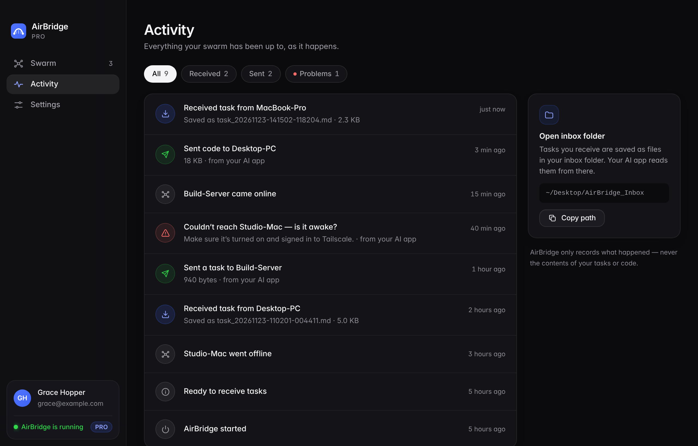

# AirBridge Pro (desktop)

AirBridge Pro is the desktop app for your **AI swarm**: every computer you own that runs
AirBridge on your private Tailscale network. It lets the AI apps on those computers (Claude
Desktop, Cursor, Codex and friends) hand tasks and code to each other, and gives you a calm
place to see what is going on:

- **Swarm** shows a live map. This computer sits in the middle and your other computers are
  arranged around it, each marked *Online* (green) or *Offline* with when it was last seen.
- **Activity** is a real-time feed written in plain sentences, such as "Received task from
  MacBook", "Sent code to Desktop-PC" and "Couldn't reach Studio-Mac — is it awake?".
- **Settings** gives you a one-click config snippet for Claude Desktop or Cursor, your account
  and plan, and the health of the background service.

Sign-in uses Clerk in your browser. A $15/month AirBridge Pro subscription (Stripe) unlocks
the app. The Python `airbridge-core` daemon starts only once a valid licence is confirmed.

## Develop

```bash
cd desktop
npm install
AIRBRIDGE_DEV_MOCKS=1 npm run dev     # fake signed-in user, valid licence, live mock swarm + events
npm test                              # vitest (renderer tests run in jsdom)
npm run typecheck
```

`AIRBRIDGE_DEV_MOCKS` is honoured only in unpackaged builds.

## Build

```bash
npm run build:backend   # PyInstaller → resources/bin/<os>-<arch>/airbridge-core
npm run build           # electron-vite: out/main, out/preload, out/renderer
npm run dist            # electron-builder installers (signing/notarisation required for release)
```

## Architecture

```
┌──────────────────────────┐  window.airbridge   ┌──────────────┐   IPC (ab:*)   ┌──────────────────────────┐
│ Renderer (React+Tailwind)│ ◀─────────────────▶ │   Preload    │ ◀────────────▶ │          Main            │
│ sandboxed, no Node, CSP  │   frozen, Promise   │ contextBridge│  sender-origin │ auth (Clerk OIDC+PKCE)   │
│ SignIn·Paywall·Swarm·…   │   based API only    └──────────────┘   validated    │ licence gate (Ed25519)   │
└──────────────────────────┘                                                    │ processManager           │
                                                                                └────────────┬─────────────┘
                                                        HTTP + WS on 127.0.0.1, bearer token │ (token never
                                                                                             ▼  leaves main)
                                                                                ┌──────────────────────────┐
                                                                                │ airbridge-core --daemon  │
                                                                                │ control API · events     │
                                                                                │ inbox :8989 (tailnet IP) │
                                                                                └────────────┬─────────────┘
                                                                                             │ Tailscale
                                                                                             ▼
                                                                                ┌──────────────────────────┐
                                                                                │ your other computers     │
                                                                                │ (tailnet peers)          │
                                                                                └──────────────────────────┘
```

The renderer only ever talks to `window.airbridge` (see `src/shared/types.ts`). It never
sees the control token or any Clerk token.

### Renderer layout (`src/renderer`)

| Path | What it is |
|---|---|
| `App.tsx` | State machine (`deriveScreen`): loading → sign in → checking → paywall / starting → ready, plus *Tailscale is off* and *stopped unexpectedly* screens |
| `views/` | `SignIn`, `Paywall`, `Starting`, `ErrorScreen`, `MainShell`, `SwarmMap`, `ActivityFeed`, `Settings` |
| `components/` | `Sidebar`, `StatusDot`, `Card`, `Button`, `CopyButton`, `EmptyState`, `Toast`, `Skeleton`, `SendTaskSheet`, `DeviceGlyph`, hand-drawn `Icons` |
| `lib/` | `api.ts` (bridge access), `hooks.ts` (5-second node polling, live events capped at 500), `format.ts` (event → sentence, relative time) |
| `styles.css` | Colour tokens as CSS variables. Dark by default, with a light palette under `prefers-color-scheme: light` |
| `devCsp.ts` | Vite plugin for the dev server only. It relaxes the CSP so HMR can work. Production keeps the strict policy |

### Design system

- **Surfaces:** a near-black canvas (`#0B0B0E`) with three layered surfaces, hairline borders
  at 6–12% alpha, soft shadows and `rounded-2xl` cards.
- **Colour:** one accent (`#3D63F5`). Green is used only for *Online*. Status always comes with
  a text label, never colour alone.
- **Type:** system stack (`-apple-system` / SF Pro, Segoe UI Variable). Spacing follows an
  8-point grid.
- **Motion:** gentle movement such as pulse rings, data packets travelling along the swarm
  links and fades on new items. All motion turns off under `prefers-reduced-motion`.
- **Accessibility:** landmarks, a skip link, visible focus rings, full keyboard navigation
  (tabs, arrow keys, Esc, ⌘/Ctrl+1–3 to switch views, ⌘/Ctrl+N for *Send a task*), live
  regions, and body text that meets WCAG AA contrast. axe-core runs in the test suite.

## Screenshots

| | |
|---|---|
|  |  |
|  |  |
|  | |

More states (empty swarm, Tailscale off, Send-a-task sheet, light mode, narrow window) are in
`docs/screenshots/extra/`. They were rendered with Playwright from the production renderer
build with a mocked `window.airbridge`.
