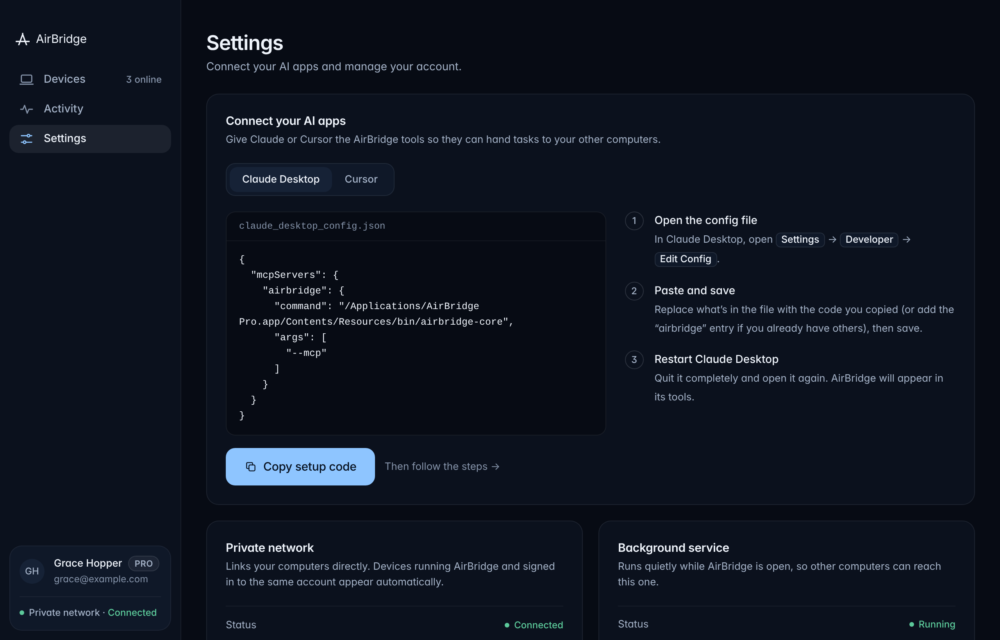
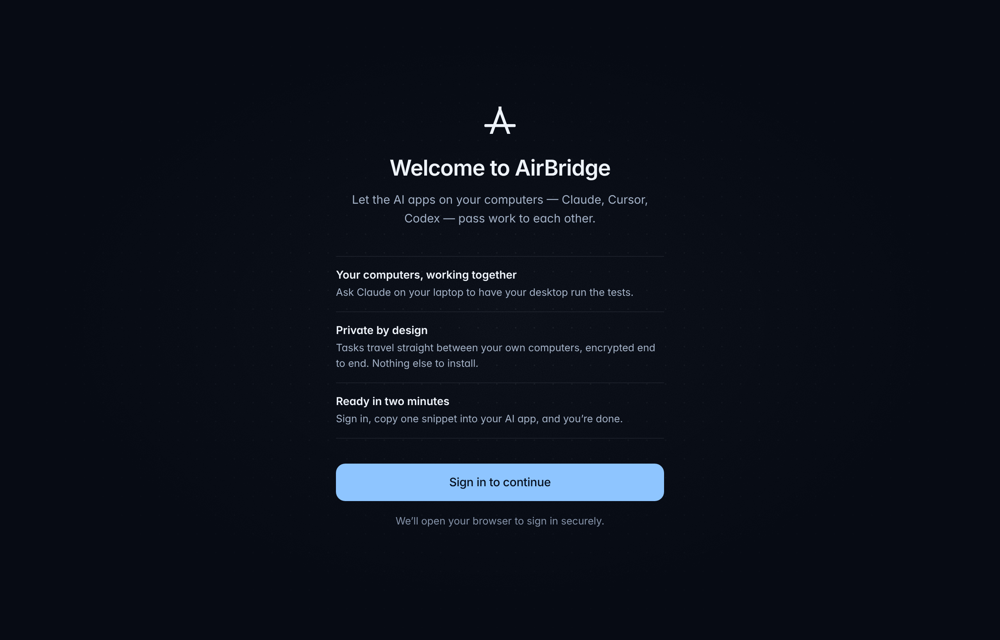
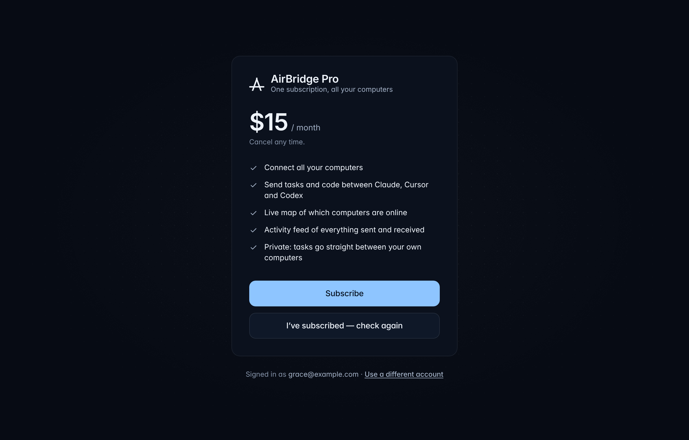
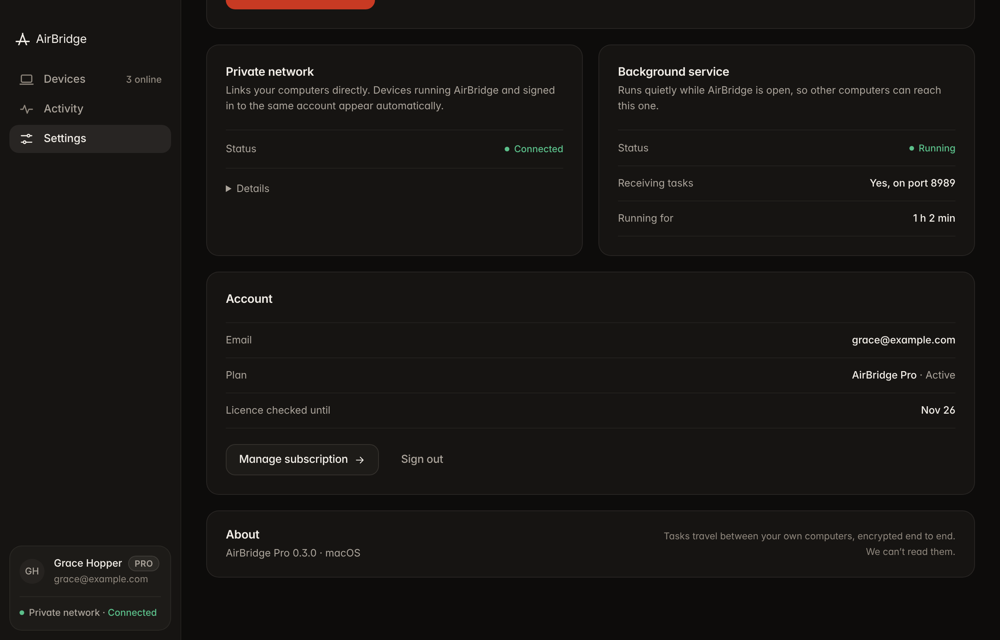

# AirBridge Pro (desktop)

AirBridge Pro is the desktop app for the computers you own. It lets the AI apps on those
computers (Claude Desktop, Cursor, Codex) hand tasks and code to each other, and gives you a
quiet place to see what is going on. It brings its own private network: there is nothing else to
install or sign in to. Any computer running AirBridge Pro and signed in to the same account
appears automatically.

- **Devices** shows a live map. This computer sits in the middle and your other computers are
  arranged around it, each marked *Online* or *Offline* with when it was last seen.
- **Activity** is a real-time feed written in plain sentences, such as "Received task from
  MacBook", "Sent code to Desktop-PC" and "Couldn't reach Studio-Mac — is it awake?".
- **Settings** gives you a one-click config snippet for Claude Desktop or Cursor, the private
  network's status (*Connected*, *Connecting…* or *Couldn't connect* with Retry; the address is
  behind *Details*), the health of the background service, and your account and plan.

Sign-in uses Clerk in your browser. A $15/month AirBridge Pro subscription (Stripe) unlocks
the app. Once a valid licence is confirmed, main starts the bundled network daemon, enrols this
computer in your account's private network, and then starts the Python `airbridge-core` daemon.
The Starting screen shows those two steps ("Connecting your private network", "Starting
AirBridge").

## Develop

```bash
cd desktop
npm install
AIRBRIDGE_DEV_MOCKS=1 npm run dev     # fake signed-in user + valid licence; this computer is
                                      # "Dev-Workstation", peers MacBook-Pro, Desktop-PC, Studio-Mac,
                                      # with live mock events
npm test                              # vitest (renderer tests run in jsdom)
npm run typecheck
```

`AIRBRIDGE_DEV_MOCKS` is honoured only in unpackaged builds.

## Build

```bash
npm run build:backend   # PyInstaller → resources/bin/<os>-<arch>/airbridge-core
npm run build           # electron-vite: out/main, out/preload, out/renderer
npm run dist            # electron-builder installers (signing/notarisation required for release)
```

### App icon

electron-builder reads `build/icon.png` (1024×1024, committed, rendered from `build/icon.svg`
with Playwright and Chrome). For release builds also generate the platform formats from it:

```bash
# macOS .icns (on a Mac)
mkdir -p build/icon.iconset
for s in 16 32 128 256 512; do
  sips -z $s $s build/icon.png --out build/icon.iconset/icon_${s}x${s}.png
  sips -z $((s*2)) $((s*2)) build/icon.png --out build/icon.iconset/icon_${s}x${s}@2x.png
done
iconutil -c icns build/icon.iconset -o build/icon.icns && rm -r build/icon.iconset

# Windows .ico (ImageMagick, any OS)
magick build/icon.png -define icon:auto-resize=256,128,64,48,32,16 build/icon.ico
```

If `icon.png` changes, re-render it from the SVG at 1024×1024 with a transparent background.

## Architecture

```
┌──────────────────────────┐  window.airbridge   ┌──────────────┐   IPC (ab:*)   ┌──────────────────────────┐
│ Renderer (React+Tailwind)│ ◀─────────────────▶ │   Preload    │ ◀────────────▶ │          Main            │
│ sandboxed, no Node, CSP  │   frozen, Promise   │ contextBridge│  sender-origin │ auth (Clerk OIDC+PKCE)   │
│ SignIn·Paywall·Devices…  │   based API only    └──────────────┘   validated    │ licence gate (Ed25519)   │
└──────────────────────────┘                                                    │ network manager + enrol  │
                                                                                │ processManager           │
                                                                                └──────┬────────────┬──────┘
                                                      local socket / pipe, never argv  │            │ HTTP + WS on 127.0.0.1,
                                                                                       ▼            ▼ bearer token (main only)
                                                   ┌─────────────────────────────┐  ┌──────────────────────────┐
                                                   │ bundled private-network     │  │ airbridge-core --daemon  │
                                                   │ daemon (userspace, no admin)│◀─│ control API · events     │
                                                   │ local SOCKS5 + LocalAPI     │  │ inbox :8989 on 127.0.0.1 │
                                                   └──────────────┬──────────────┘  └──────────────────────────┘
                                                                  │ encrypted (WireGuard), same account only
                                                                  ▼
                                                   ┌─────────────────────────────┐
                                                   │ your other computers running│
                                                   │ AirBridge Pro               │
                                                   └─────────────────────────────┘
```

In short: renderer ⇄ preload ⇄ main ⇄ (bundled private-network daemon + `airbridge-core`).
The network daemon is built from the open-source Tailscale client (BSD-3; licence notices ship
in `resources/licenses/`) and talks only to AirBridge's own coordination server. See
`../airbridge/docs/PHASE3_PLAN.md`. The app UI never names it; it is just "your private network".

The renderer only ever talks to `window.airbridge` (see `src/shared/types.ts`). It never
sees the control token or any Clerk token.

### Renderer layout (`src/renderer`)

| Path | What it is |
|---|---|
| `App.tsx` | State machine (`deriveScreen`): loading → sign in → checking → paywall / starting (two steps: network, then backend) → ready, plus *Couldn't connect your devices* (network error) and *stopped unexpectedly* screens |
| `views/` | `SignIn`, `Paywall`, `Starting`, `ErrorScreen`, `MainShell`, `SwarmMap`, `ActivityFeed`, `Settings` |
| `components/` | `Sidebar` (footer line "Private network · Connected"), `PrivateNetworkCard`, `StatusDot`, `Card`, `Button`, `CopyButton`, `EmptyState`, `Toast`, `Skeleton`, `SendTaskSheet`, `DeviceGlyph`, hand-drawn `Icons` |
| `lib/` | `api.ts` (bridge access), `network.ts` (`window.airbridge.network` status hook, plain-language states), `hooks.ts` (5-second node polling, live events capped at 500), `format.ts` (event → sentence, relative time) |
| `styles.css` | Colour tokens as CSS variables. Dark by default, with a light palette under `prefers-color-scheme: light` |
| `devCsp.ts` | Vite plugin for the dev server only. It relaxes the CSP so HMR can work. Production keeps the strict policy |

### Design system

The aim is restraint in the spirit of Apple's System Settings and Find My. Hierarchy comes from
type, spacing and alignment, not from effects.

- **Brand:** the mark is concept (d), the A-frame pylon: a bridge tower that doubles as the
  "A" of AirBridge. A short mast head, flat-cut feet and a road deck that runs past both legs
  make it read as a pylon rather than a letter. It is monochrome (`currentColor`) and crisp at
  16px. The concepts sheet (`docs/brand/logo-concepts.png`), the chosen mark
  (`docs/brand/logo.svg`, mirrored in `LogoMark` in `components/Icons.tsx`) and the palette
  sheet are in `docs/brand/`. The app icon is `build/icon.svg` (International Orange on
  near-black), rendered to `build/icon.png` at 1024×1024.
- **Colour:** a warm near-black canvas (`#0D0C0B`) with a subtle film grain and dot grid, warm
  off-white text (`#F2EEE8`) and warm greys. There is one accent, **International Orange**
  (`#C83A23` dark / `#C0362C` light, the Golden Gate's paint). It is used only for the single
  primary action on a screen. A calm green is used only for *Online*. Every text pair meets
  WCAG AA; see `docs/brand/palette.png`.
- **Surfaces:** flat cards with hairline borders and `rounded-2xl` corners. There are no glows,
  gradients or glass blur, and only overlays (sheet, toast) cast a shadow.
- **Status:** a small solid dot plus text, never colour alone and never pulsing.
- **Motion:** almost none. There are short one-shot fades for new items and the sheet, and a
  link on the device map brightens briefly when a task is sent. Nothing loops except the
  loading spinner. Everything turns off under `prefers-reduced-motion`.
- **Type:** system stack (`-apple-system` / SF Pro, Segoe UI Variable). Spacing follows an
  8-point grid.
- **Accessibility:** landmarks, a skip link, visible focus rings, full keyboard navigation
  (tabs, arrow keys, Esc, ⌘/Ctrl+1–3 to switch views, ⌘/Ctrl+N for *Send a task*), live
  regions, and body text that meets WCAG AA contrast. axe-core runs in the test suite.

## Screenshots

| | |
|---|---|
|  |  |
|  |  |
|  |  |

More states (Starting steps, network error, private network *Details* and *Connecting…*, no
other devices, Send-a-task sheet, light mode, narrow window) are in `docs/screenshots/extra/`.
They were rendered with Playwright (system Chrome) from a production Vite build of
`src/renderer` with a mocked `window.airbridge`.

<!-- Section owned by Systems (main process / backend). UI/UX sections are above. -->

## Test the real app today (preview: no servers needed)

Preview builds (the default until the app is approved, PHASE3_PLAN.md §8) need no Clerk, no license
server and no Headscale. Without sign-in the engine runs on **this computer's own Tailscale**
(`AIRBRIDGE_NETWORK=system`); the bundled `tailscaled` is never started.

1. Install Tailscale on each computer you want to test with and sign them into the same tailnet
   (`tailscale status` should list them). Without it the app opens on the "Couldn't connect your devices"
   screen (`docs/screenshots/extra/preview-real.png`); Retry once Tailscale is up.
2. Get the code and the desktop dependencies:
   ```bash
   git clone https://github.com/Kobby-Adjei/gurudreamsv1.git
   cd gurudreamsv1/desktop
   npm install
   ```
3. Give the app a backend, either:
   - build it once: `npm run build:backend` (PyInstaller -> `resources/bin/<os>-<arch>/airbridge-core`;
     used automatically when present), or
   - run it from source: `python3 -m venv ~/abvenv && ~/abvenv/bin/pip install -r ../airbridge/requirements.txt`,
     then export `AIRBRIDGE_PYTHON=~/abvenv/bin/python` (only used when no built binary exists).
4. Start it **without** `AIRBRIDGE_DEV_MOCKS` (and don't copy `.env.example`, which turns mocks on):
   ```bash
   npm run dev
   ```
   The main-process log shows `license enforcement: off (preview …)` and the engine starts straight away.
   Settings -> Account still offers sign-in; with `CLERK_OAUTH_*` + `AIRBRIDGE_LICENSE_URL` configured and a
   license server running with `ENFORCE_ENTITLEMENT=false`, signing in moves the engine onto the embedded
   private network (it restarts once); signing out moves it back to the system Tailscale.

`AIRBRIDGE_DEV_MOCKS=1 npm run dev` still gives the fully mocked demo (no engine, no network).

## Launch checklist (turn licensing on)

Do these together, only after the product owner approves the app:

1. **Desktop build flag:** build with `MAIN_VITE_AIRBRIDGE_ENFORCE_LICENSE=1` (CI env or `desktop/.env`).
   It is inlined at compile time, so a shipped app cannot be flipped back at runtime. Check the bundle:
   `grep -A2 'function licenseEnforced' out/main/index.js` must show `return true`.
2. **License server:** set `ENFORCE_ENTITLEMENT=true` (the production default; preview uses `false`) so
   `/v1/network/preauth-key` only issues keys to paying users.
3. **Desktop config baked in:** `MAIN_VITE_AIRBRIDGE_LICENSE_URL`, `MAIN_VITE_CLERK_OAUTH_ISSUER`,
   `MAIN_VITE_CLERK_OAUTH_CLIENT_ID` and the production license public keys (`publicKeys.ts`). An
   enforced build without them keeps the engine **blocked** ("Sign-in is not configured in this build").
4. **Embedded network:** bundled `tailscaled`/`tailscale` present (`npm run build:tailscale`) and Headscale
   reachable at the license server's `HEADSCALE_PUBLIC_URL`; enforced builds always use the embedded
   network, never the user's own Tailscale.
5. **Smoke test the enforced build:** signed out -> sign-in wall and no `airbridge-core` process;
   inactive subscription -> Paywall, engine blocked; active -> private network connects, then the engine.
   `npx vitest run tests/previewMode.test.ts` covers both modes.
6. Remove the "Preview" label / preview copy if UI/UX hasn't gated it on `LicenseStatus.enforced` already.
